  

<h3 align="center">📍 Erasmus intern in Cork.</h3>

  
  &nbsp;&nbsp;&nbsp;
  
  &nbsp;&nbsp;&nbsp;
  

  
    
  
  

    I've been into software for quite some time, and I just like to code. 
    Mostly <b>front end</b>, but I can work with <b>back end</b> and other kinds of software too.
  

  
    
  

  
    
  <picture>
    <source media="(prefers-color-scheme: dark)" srcset="https://raw.githubusercontent.com/igoresik/igoresik/output/pacman-contribution-graph-dark.svg">
    <source media="(prefers-color-scheme: light)" srcset="https://raw.githubusercontent.com/igoresik/igoresik/output/pacman-contribution-graph.svg">
    
  </picture>

