  <picture>
    <source media="(prefers-color-scheme: dark)" srcset="./assets/header.svg">
    <source media="(prefers-color-scheme: light)" srcset="./assets/header-light.svg">
    
  </picture>

<h3 align="center">📍 Erasmus intern in Cork.</h3>

  
  &nbsp;&nbsp;&nbsp;
  
  &nbsp;&nbsp;&nbsp;
  

  <picture>
    <source media="(prefers-color-scheme: dark)" srcset="./assets/title-about.svg">
    <source media="(prefers-color-scheme: light)" srcset="./assets/title-about-light.svg">
    
  </picture>
    
  <picture>
    <source media="(prefers-color-scheme: dark)" srcset="./assets/about.svg">
    <source media="(prefers-color-scheme: light)" srcset="./assets/about-light.svg">
    
  </picture>
  

    I build software people can download and use. 
    Mostly <b>Python</b>, also <b>Java</b> and <b>Android</b>, and <b>Next.js</b> for the web.
  

  <picture>
    <source media="(prefers-color-scheme: dark)" srcset="./assets/title-stack.svg">
    <source media="(prefers-color-scheme: light)" srcset="./assets/title-stack-light.svg">
    
  </picture>
    
  

  <picture>
    <source media="(prefers-color-scheme: dark)" srcset="./assets/title-activity.svg">
    <source media="(prefers-color-scheme: light)" srcset="./assets/title-activity-light.svg">
    
  </picture>
    
  <picture>
    <source media="(prefers-color-scheme: dark)" srcset="https://raw.githubusercontent.com/igoresik/igoresik/output/pacman-contribution-graph-dark.svg">
    <source media="(prefers-color-scheme: light)" srcset="https://raw.githubusercontent.com/igoresik/igoresik/output/pacman-contribution-graph.svg">
    
  </picture>

